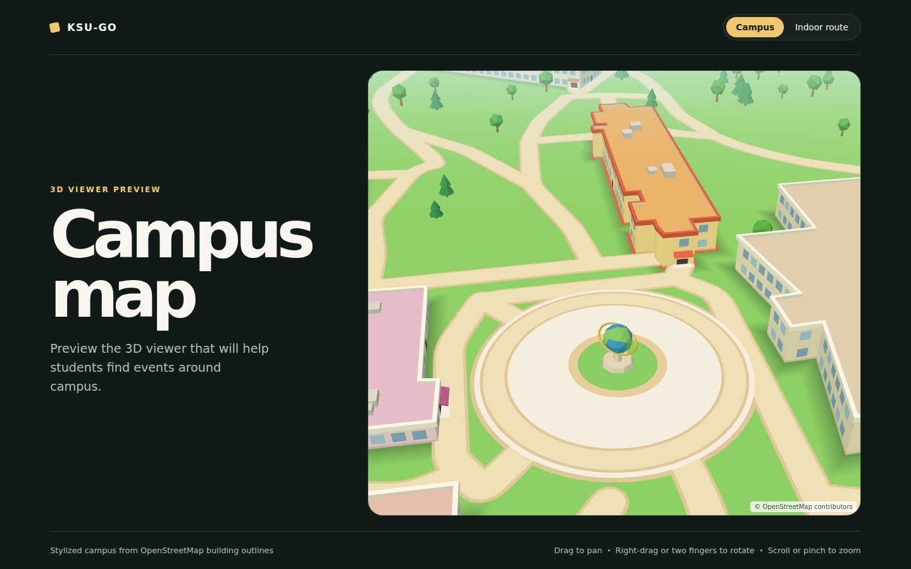

# KSU-GO 3D viewer

**MAP-2 gives the campus map and indoor directions one 3D viewer.** Open it in Chrome to try either scene with sample data. The same build produces one HTML file for the Expo app to load offline.



The campus tab shows a stylized low-poly campus built from the OpenStreetMap outlines in `campus.json`: drag to pan, right-drag or use two fingers to rotate, and scroll or pinch to zoom. Event flags (MAP-4) attach to its buildings, and the indoor route tab still shows a blue sample cube until the route tickets land.

## Run the demo

Use Node **22.12+ on the Node 22 line**, or Node **24 LTS**. Start in the repository root. In Windows PowerShell, use `npm.cmd` if script execution blocks `npm`.

```sh
npm ci
cd viewer
npm ci
npm run dev
```

Open the URL printed by Vite. The **Campus** tab uses `?scene=campus`, and **Indoor route** uses `?scene=route`. Campus mode loads the shared campus fixture and events starting within the next 24 hours, including events already in progress. Route mode loads the shared sample route.

To try the built version, run `npm run build` inside `viewer/` and open `dist/index.html` directly in Chrome. Switch between tabs with the dev server stopped to try the local file on its own.

## Where to make changes

| File | What it owns |
| --- | --- |
| [`src/campus/index.ts`](src/campus/index.ts) | Campus map scene: camera framing, pan, pinch and rotate limits, render on demand, the OpenStreetMap credit, and the marked spot where MAP-4's `createFlags` call goes. Geometry is built in [`src/campus/build.ts`](src/campus/build.ts), one mesh per building tagged with `userData.buildingId`, with colors from [`src/palette.ts`](src/palette.ts). |
| [`src/route/index.ts`](src/route/index.ts) | Entry point for indoor geometry and route interactions. |
| [`src/scene.ts`](src/scene.ts) | The `load`, `handle`, and `dispose` scene interface and the current sample geometry. |
| [`src/main.ts`](src/main.ts) | Selects the active scene, forwards messages, and disposes the previous scene when switching. |
| [`src/bridge.ts`](src/bridge.ts) | Registers the app message receiver and sends typed replies. |
| [`src/browser.ts`](src/browser.ts) | Turns shared fixtures into the same load messages the app will send. |
| [`src/preview.css`](src/preview.css) | Styles the Chrome presentation. The Expo WebView displays the canvas full-screen. |

The WebView waits for `ready`, then calls `window.ksugo.receive(message)` with `campus:load` or `route:load`. Chrome runs the same scene selection with fixture data and logs replies to its console. Use the [viewer bridge contract](../CONTRACTS.md#6-viewer-bridge) for message shapes as you add interactions.

## Next ticket

**MAP-4 is the next viewer ticket to look for in Todo once MAP-2 merges.** MAP-2 is its only hard blocker. MAP-4 can start with the campus fixture and placeholder geometry while MAP-3 builds the campus.

1. Read the flag rules in [Contracts §2](../CONTRACTS.md#2-events). Work from the `events` and `now` passed in `campus:load` so the same data produces the same flags in Chrome and Expo.
2. Add a flag module under `src/campus/`. Place each active flag at its building entrance. Use timing to set its height and state, give live flags a pulse, and spread out flags that share a building.
3. Wire up the two interactions. A tap sends `campus:flagTapped` with the event ID. A `campus:select` message highlights that event’s flag and moves the camera. A `null` ID clears the selection.
4. Handle a second `campus:load` by refreshing flags without rebuilding buildings. Test the exact 0-, 60-, and 240-minute boundaries. Try several flags on one building in Chrome, then check their touch targets on the demo iPhone.

See the [MAP-4 ticket](../TICKETS.md#map-4-event-flags) for its acceptance criteria. Confirm it is available on the live board before starting.

| Follow-on work | What it adds |
| --- | --- |
| **MAP-1 → MAP-3** | Choose the campus layout and visual style, then build the walkways, trees, and buildings. The campus scene will use building IDs that the flags can attach to. |
| **APP-2 → APP-3** | Load the viewer in Expo Go, then connect flag taps to the event card and registration. |
| **MAP-3 + MAP-4 → MAP-5** | Add building labels and a flag legend once the map and flags are in place. |
| **ROUTE-1 → ROUTE-2 → ROUTE-3** | Turn route steps into positions, draw the halls and stairs, then move the camera along the route. |
| **ROUTE-4 + APP-4** | Turn the same steps into plain-language directions and show them alongside the route in the app. |

## Expo handoff and verification

From `viewer/`, build and export the HTML for APP-2:

```sh
npm test
npm run build
node scripts/export-html.mjs ../app/src/viewerHtml.ts
```

APP-2 can pass the exported string to `source={{ html: viewerHtml }}`. To finish the phone check, open the app in Expo Go on a physical iPhone, load each scene, turn on airplane mode, then verify that each scene can still redraw and respond to gestures.

| Check | MAP-2 result |
| --- | --- |
| Chrome previews | Both fixture scenes rendered from the local HTML with the correct tab active. |
| Offline artifact | The build emitted only `dist/index.html`, about 576 kB before compression. JavaScript and styles are inlined. |
| Bridge and fixtures | Three viewer tests passed, covering native `ready`, unknown-message recovery, and the campus fixture event window. The build also ran the viewer type check. |
| Physical iPhone in airplane mode | Pending APP-2’s `ViewerWebView`. |

[Full project ticket list](../TICKETS.md)
